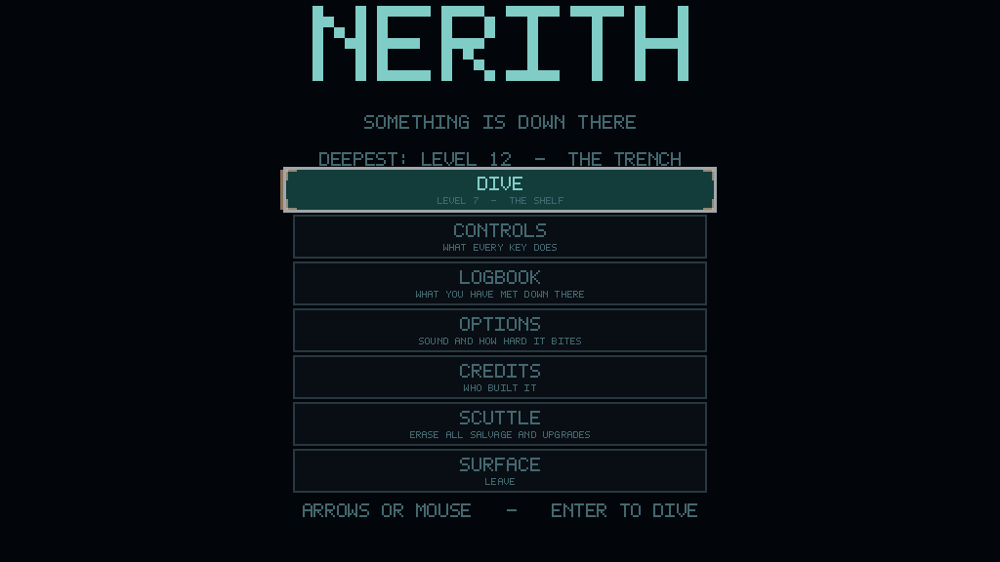
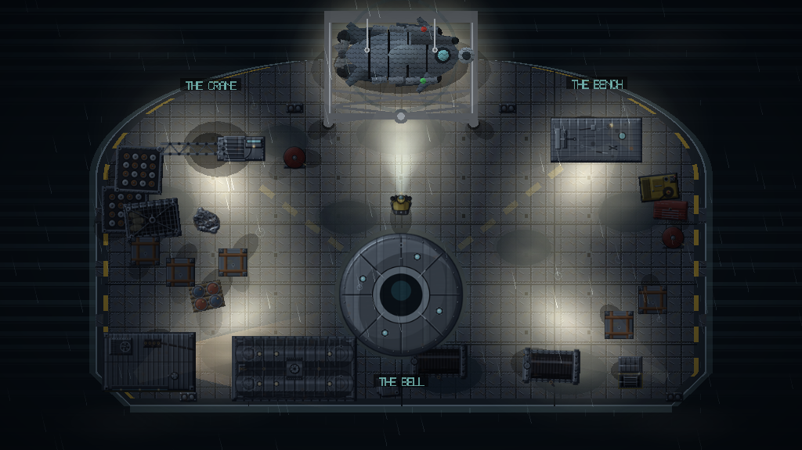
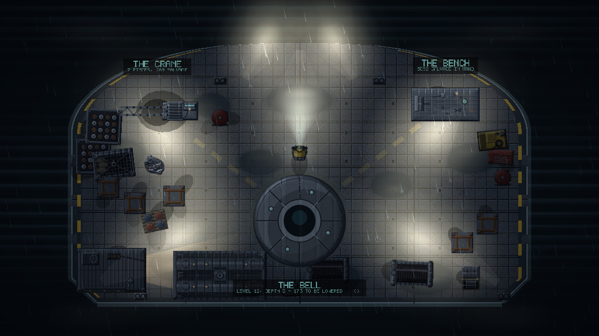
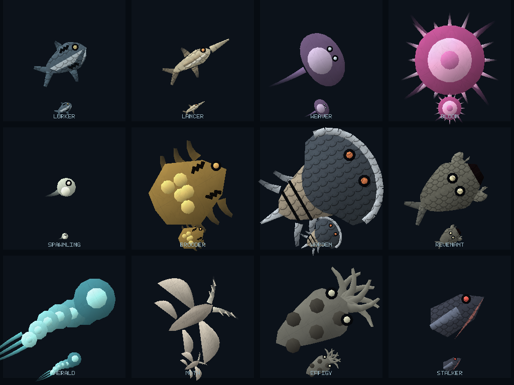
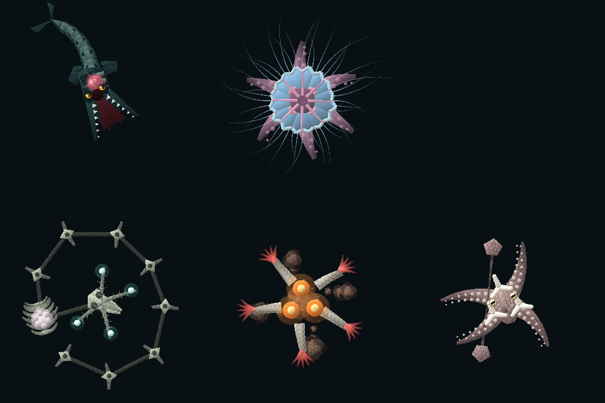
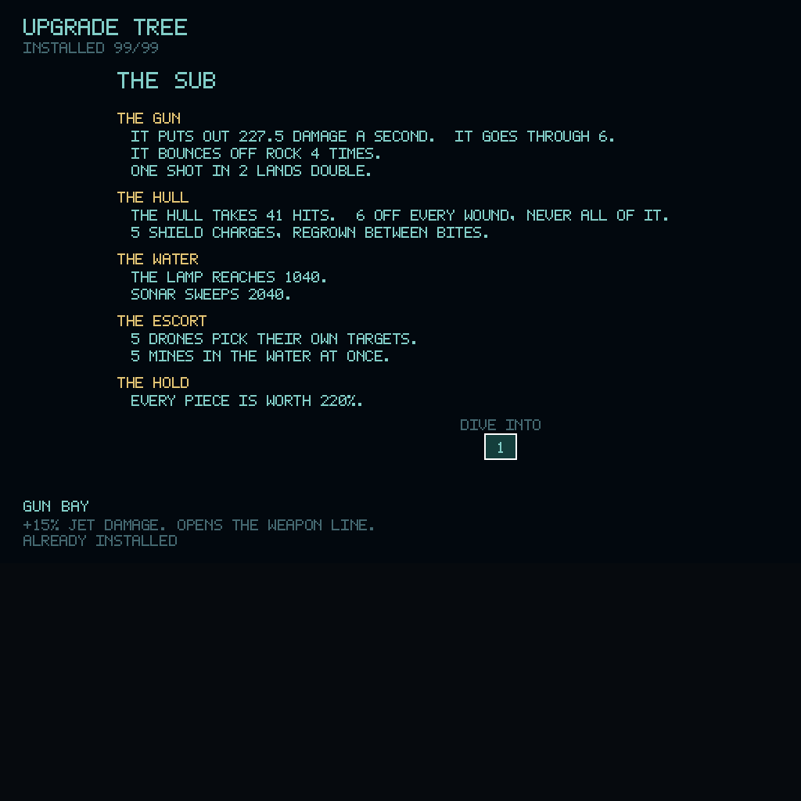

# Nerith — čo bolo, čo je a čo bude

Sep 21, 2026 · @Autodesk

## Čo Nerith je

2D top-down podvodná horor-strieľačka. Ponorka, tmavý bazén, lampa čo vidí len kúsok, a niečo v tej tme. Hráč sa spúšťa výťahom po poschodiach, zbiera salvage zo dna, vynára sa s nákladom a míňa ho v strome vylepšení. Kampaň má **30 levelov v 6 hĺbkach**, každé piate poschodie stráži boss.

Príbeh: firma stratila v Nerith tri posádky. Ty si štvrtý v poradí. Poistka je zaplatená, otázky sa nekladú.

### Pevné obmedzenia

Tieto sa nemenia a všetko ostatné sa im podriaďuje:

- **Čisté C++20 a SFML 3** (3.0.2), Visual Studio / MSBuild, x64. Žiadny engine, žiadne nové závislosti.
- **Žiadne nahrané médiá.** Každá textúra aj každý zvuk sa generuje kódom.
- Čistá, jednoduchá, rozšíriteľná architektúra. **Žiadny overengineering.**
- Git, a **každá zmena sa commitne**.
- Papo hrá zo **zbaleného buildu v `dist/`**, takže po opravách treba `tools/package.ps1`.
- Komunikácia po slovensky.

**Shadery sú dva, obe v GLSL priamo v kóde** (`sf::Shader` je súčasť SFML, nie nová závislosť). `WaterPass` beží cez celý osvetlený bazén medzi svetlom a tmou: voda jemne vlní obraz, svetlé veci majú v zakalenej vode halo, farba sa s odstupom od lampy mení na modrú a zásah roztrhne farebné kanály. Druhý rozmazáva popredie v cutscéne. Na karte bez shaderov sa absorpcia kreslí ako predtým, geometriou.

## Ako je to postavené

**Vrstvy.** `core/` (Game slučka, Config, Assets, Random), `entities/` (Player, Enemy, Boss + BossDef/BossMind/BossArt), `world/` (Arena, Seabed, DepthTheme, LevelDef, Objective), `effects/` (ParticleSystem), `upgrades/` (Stats). `Config.h` je centrálny uzol balansu — takmer každé číslo hry žije tam.

**Bossovia = telo × myseľ × koža.** `BossBody` (rozloženie článkov), `BossMind` (správanie), `BossSkin` (kreslenie). Kľúčový poznatok: **koža kreslí to, čo robia články**, takže nový tvar bossa je nové rozloženie, nie nový kresliaci kód. Telá: Serpent, Bell, Ring, Split, Tower, Coil.

**Staty cez jeden bod.** Všetko čítanie statov ide cez `Stats::get`, ktorý na konci aplikuje strop z tabuľky `Ceiling` v `Stats.cpp`. To je jediné miesto, kde sa dá zastaviť OP kombinácia (ricochet, burst, armour...).

**Objectives na volacom mieste.** `Hunt`, `Restore`, `Defend`, `Escape` cez virtuály `onQuarryKilled/onMarkLit/onWardBitten/onReachedMouth` a `preyFor()` trik v `Game.cpp` — bez zmien v `Enemy`.

**Kampaň = tabuľka.** 30 riadkov v `LevelDef.h`: maxAlive, intervaly, objective, hĺbka. Krivka: pomaly hore, strmo na konci.

### Procedurálny pipeline

- **Art:** PowerShell + System.Drawing pod `tools/`. `make_3d.ps1` orchestruje, `relief.ps1` dáva grain/highlight, `organic.ps1` je slovník tvarov (Body, Fin, Limb, Eye, Lamp, Gills, Plates...). Seedy z názvu súboru. Nové: `make_gear.ps1`, `make_dress.ps1`, `deck_sub.png` v `make_deck.ps1`.
- **Audio:** procedurálny C# `Synth` vložený v PowerShelli.
- **Balenie:** `tools/package.ps1` → `dist/Nerith/`.

## Ako sa to overuje

**Nie botom.** Pilot (bot čo hrá hru) bol odstránený — hra je príliš zložitá na to, aby ju vedel konzistentne odohrať, a bil sa s čímkoľvek namiesto plnenia cieľov. Namiesto neho:

- **Analytický model balansu** — `tools/balance.cpp` + `balance.ps1`. Modeluje ekonomiku (príjem za kampaň vs cena stromu) aj krivku bossov (čas na zabitie). Práve model odhalil, že jedna kampaň má kúpiť \~tretinu stromu (35 %) a že boss krivka bežala pozpiatku (Leviathan 129 s vs Furnace 42 s).
- **Headless harnessy** v scratchpade — vyrenderujú scénu do textúry a načítajú späť Read toolom: `reelshot`, `treeshot`, `lightshot`, `shadowbench`, `bosses`, `acts`, `deckwalk`, `water`, `reach`, `goals`, `dresscheck`. Pozor: softvérový GL v tejto session limituje render textúru na 1024×1024.
- **Testy:** `tests/run_tests.ps1` (\~839 kontrol) po každej zmene.

Merané veličiny sú číselné: opacita okraja, cena tieňov v ms, alpha častíc, prenesená vzdialenosť, dosah dotyku bossa zametaný cez uhol.

## Čo bolo spravené

Zoskupené do tém, nie striktne po commitoch.

**Ekonomika a krivka ťažkosti.** `SalvageTable` orezaná \~5×, prenálada nálezov a prvého čistenia, streak bonus. Cúľ: jedna čistá kampaň = \~tretina stromu (z 15 % na 35 %). Krivka maxAlive prepísaná: pomalý štart (3–4), strmý koniec (až 16), pomalšie ské intervaly na začiatku.

**Opravená OP ponorka.** Príčina boli tri veci naraz: 12 flat armour proti 1–3 dmg s pravidlom „nikdy pod 1“, 2,5 s naskladanej mercy, a dash s 90 % zníženým cooldownom + GHOST. Riešenie: `ArmourFloor` (časť každého zásahu vdy prejde), `DashMinCooldown`, a stropy statov v `Ceiling`.

**Odstránený mechanizmus „damage láme systémy“.** Celý `HullBreakAt` / `Broken*` blok preč.

**Bossovia dostali telo.** Ring, Split, Tower, Coil ako nové rozloženia — štyri zo šiestich majú teraz naozaj inú siluetu, nie centrálne jadro s chapadlami. `segmentReach` opravil hitboxy (split bell už nemá dotyk cez pôl obrazovky). Bossovia zjemnení — Leviathan ako prvý už nie je najtžší.

**Cutscéna.** Menené predné rímsy, opravené čierne zábery (`gloom` quady bežali pozpiatku), `rock()` násobí sheet takže tinty museli zdvojnásobiť.

**Voda a svetlo.** Absorpcia farby (`BlendMultiply` prstenì, červená mizne prvá), tiene sférovým trasovaním na hraniciach segmentov, drift bazenu, mote lift v lúči. Kúskovanie kamery (`CameraZoom`).

**Prostredie a QoL.** 5 `gear_*` podlahových objektov (salvage ciele, šachta, vent), dekor hĺbok (`dressing` + `dressShare`, 0–45 % podľa hĺbky), šípka k cieľu (`LostArrow`), zhrnutie dive-u (`Report`), oprava z-orderu textov v strome vylepšení, dva beacony už nepadajú na to isté miesto (`getRooms` nie `getChambers`).

**Nové objectives.** Hunt, Restore, Defend, Escape — žiadna hĺbka neprosí o to isté dvakrát.

**Od poslednej aktualizácie dokumentu (\~20 commitov, stav k 2026-09-23):** všetkých 12 tvorov prekreslených procedurálne s poctivou anatómiou; ponorka kreslená rovnako a rovnako na palube aj vo vode; paluba je tvarovaný trup lode, nie obdĺžnik; štyri povrchy tvorov (šupina, mäkké, plát, srsť); tieňovanie cez vrcholové farby; štyri tvary častíc v jednom draw calle; položiteľné svetelné majáky na `G`; hudba podľa prostredia; animácie tlačidiel; podržanie na scuttle; ukladanie postupu v leveli; odstránené skratky Tab a Esc+Q; vizuálny upgrade stromu (vlastná farba na vetvu, záložka); font prestal lámať ťahy a tlačiť písmená na seba; v creditoch je Patrik Nottný.

## Čo je rozrobené a čo je riziko

- **Nikto to nehral.** Toto je najväčšie riziko projektu. Všetko je overené modelom, headless rendermi a 847 testami — ani jedna z posledných dávok nebola odohraná rukami na klávesnici.
- **Zóny dopadu má len `SOUND`.** Ostatné bossí špeciály dopadnú vo frame, keď sa zaradia. Dať náskok každému mení, čo súblej pýta — vlastný priechod s prepočítaným modelom.
- **Eskortný dron je stále sprite** (`att_drone.png`). Jediná vec v vode, ktorá nie je kreslená procedurálne.
- **Staré savy** sú po zmene cien chudobnejšie, a uložené klávesy zlej dĺžky sa vrátia na defaulty.
- **Predchádzajúca verzia tohto dokumentu tvrdila, že audio pipeline je osirotený. Nebola to pravda** — všetkých 27 „osirotených“ wavov generát `make_audio_surface.ps1`, len ich nič nespúšťalo. Opravené skriptom `make_sound.ps1`.

## Čo bude

Zoradené podľa priority.

1. **Odohrať to.** Všetko ostatné stojí na dôvere v model a rendery.
2. **Zóny dopadu pre zvyšné bossí špeciály** — systém stojí (`addDanger`, disk alebo klín s hodinami), treba dať každému špeciálu náskok a prepočítať krivku.
3. **Dron procedurálne**, nech je vo vode konzistentné všetko.
4. **Skala v aréne** je plochý tint bez štruktúry; hĺbky sa líšia hlavne pozadím, nie gradingom celej scény.
5. **UI nemá jednotný jazyk** — HUD, strom, paluba a menu si každý vymyslel vlastné rámčeky.

## Rozhodnutia, čo sa oplatí pamätať

- **Balans merať modelom, nie botom.** Autopilot na túnto hru nefunguje.
- **Koža bossa kreslí články** — nový tvar = nové rozloženie, nie nový kresliaci kód.
- **Stropy statov sú jediná obrana** proti OP kombináciám — držaš ich v `Ceiling`.
- **Overovať renderom, nie okom** — headless do textúry + Read tool našiel dve chyby, čo by inak spadli až v hre (nenačítané `gear_*` textúry → crash; z-order textov v strome).

### Chyby, čo sa nemajú zopakovať

- **perl ničí `\n` v C++ string literáloch** → používať PowerShell `[IO.File]` replace alebo Write tool.
- **`getChambers()` vracia stovky drobných „hĺtov“**, nie miestnosti — na rozmiestnenie použiť `getRooms()`.
- **`sf::VertexArray` defaultuje na `Points`** — vždy dať `Triangles` v ctor.
- **Softvérový GL limituje render textúru na 1024×1024.**
- **Aplikovať tému hĺbky PRED reshape** — inak dostane bazén dekor predchádzajúcej hĺbky.

## Referencia: ovládanie

| Kláves | Čo robí |
| --- | --- |
| W A S D | plavba |
| myš | mierenie, ľavé tlačidlo streľba |
| Shift | dash (treba trait) |
| F | lampa zap/vyp |
| E | prepnutie režimu zbrane |
| G | položiť svetelný maják (treba `LANTERN`) |
| Esc | pauza / o krok späť |
| Tab | v strome: prepnutie na stránku THE SUB |
| +/- | zoom stromu |
| R | v strome: respec (dvakrát) |

**Nie sú žiadne skratky na vynorenie ani na otvorenie stromu počas ponoru.** Cesta hore je zvon alebo dno; cesta k salvage je prejsť na palube k lavici. Bolo to odstránené zámerne.

## Referencia: kampaň

30 levelov, 6 hĺbok po 5. Každý piaty je boss.

| Hĺbka | Názov | Boss |
| --- | --- | --- |
| 1 | THE SHALLOWS | Leviathan |
| 2 | THE SHELF | Bloom Sovereign |
| 3 | THE TRENCH | Trench Worm |
| 4 | THE ABYSS | The Hollow |
| 5 | THE VENTS | The Furnace |
| 6 | THE CRADLE | The Mother |

**Objectives:** LiftQuota, RunDark, OpenWrecks, RecoverRig, SurviveTime, DestroyNests, HaulCargo, Hunt, Restore, Defend, Escape, Boss. Žiadna hĺbka nepýta to isté dvakrát.

**Postup v leveli sa uloží, ak sa vynoříš živý.** Smrť ho zmaže. Dokončený level si nedrží nič a boss nikdy.

## Referencia: tvory

Všetkých 12 je kreslených procedurálne (`creatureart` v `BossArt.cpp`), s poctivou anatómiou a vlastným povrchom.

| Tvor | Správanie | Povrch |
| --- | --- | --- |
| Lurker | ide rovno na teba | šupina |
| Lancer | telegrafuje, potom rovná čiara | šupina |
| Weaver | krúži na diaľku, vejáre | mäkký |
| Bloom | necháše, kruhy úrlov | mäkký |
| Spawnling | jeden zásah, plní vodu | mäkký |
| Brooder | liahne, treba zabiť zdroj | mäkký |
| Warden | **pancier len spredu** | plát |
| Revenant | pod dnom, potom pri tebe | šupina |
| Herald | neútočí, osvetlí a spevní ostatných | mäkký |
| Moth | slepá, loví lampu | srsť |
| Effigy | hýbe sa, len keď sa hýbeš ty | mäkký |
| Stalker | sleduje ťa z predošlého levelu | šupina |

**Wardenovo pravidlo nie je nikde napísané** — učí sa uchom: odraz od panciera má vlastný zvuk a iskry idú po odrazenej dráhe.

## Referencia: bossovia

Každý je **telo × myseľ × koža**. Koža kreslí to, čo robia články — nový tvar je nové rozloženie, nie nový kresliaci kód.

| Boss | Telo | Myseľ | Čo robí |
| --- | --- | --- | --- |
| Leviathan | Serpent | Prowler | krúži, nabehne |
| Bloom Sovereign | Bell | Drifter | pomalý rytmus |
| Trench Worm | Coil | Burrower | norí sa a vynára inde |
| The Hollow | Ring | **Encircler** | prstenec s jedinou medzerou, ktorá obieha |
| The Furnace | Tower | **Bastion** | nehýbe sa, delostreľba + výuch |
| The Mother | Split | **Weaver** | vlnovka, dve salvy naraz |

Krivka (DESCENT): 46 → 55 → 70 → 85 → 100 → 120 sekúnd.

## Referencia: ekonomika a obtiažnosť

Jedna čistá kampaň kúpi **\~35 %** stromu (100 uzlov, 17 127 salvage). Príjem: 20 % otvorenie vody, 47 % zabíjanie, 33 % dno.

| Preset | Kúpi | Bite/s | Naraz živých | 1. boss | Posl. boss |
| --- | --- | --- | --- | --- | --- |
| SURVEY | 29 % | 11,2 | 6,8 | 34 s | 90 s |
| DESCENT | 35 % | 24,0 | 8,8 | 46 s | 120 s |
| ABYSSAL | 43 % | 44,1 | 10,8 | 56 s | 146 s |

**Stropy statov sú jediná obrana** proti OP kombináciám — `Ceiling` v `Stats.cpp`, jediný bod, cez ktorý idú všetky čítania.

## Referencia: nástroje

| Skript | Čo robí |
| --- | --- |
| `tools/make_3d.ps1` | orchestruje všetok art (21 skriptov) |
| `tools/make_sound.ps1` | orchestruje všetko audio (2 skripty) |
| `tools/make_hide.ps1` | 4 povrchy tvorov |
| `tools/balance.ps1` | model ekonomiky, krivky bossov a presetov |
| `tools/package.ps1` | build + zip do `dist/` |
| `tests/run_tests.ps1` | 847 kontrol |

Všetko je **deterministické** — rovnaký seed, rovnaké bajty. Wav, ktorý sa po regenerácii zmení, znamená, že sa naozaj zmenil synth.

## Časté otázky

**Prečo sa tvory tieňujú vrcholmi a nie shaderom?** Lebo to stačí a nič to nestojí: smer od ťažiska tvaru k vrcholu voči svetlu, jeden skalárny súčin na vrchol. Shader robí len to, čo po pixeloch geometria nevie — vodu, halo, absorpciu a rozmazanie. Dlho sa tvrdilo, že shadery projekt „nemá"; nebola to pravda, len predpoklad.

**Prečo je všetko kreslené a nie textúry?** Obrázok zvieraťa držaný v jednom uhle je obrázok, nie zviera — nedýcha, neotvára papuľe a nevie sa na teba pozrieť. Sprity ostali len na dekor paluby, salvage a dron.

**Prečo boss\_hide vyzerá ako šupiny aj na ponorke?** Už nie — ponorka používa `hide_plate.png` s dvojnásobným opakovaním. Plátovanie stroja je menší vzor než koža zvieraťa.

**Prečo sa font kreslí po pixeloch?** Každý svietiaci pixel glyfu je jeden quad. Ťahy sú v celých pixeloch, rozostupy v pôvodnej mierke — keby boli oba zaokrúhlené, malé popisy stratia pätinu veľkosti; keby ani jeden, ťahy sú nerovnomerné.

**Čo keď ma niečo zablokuje v bazéne?** Cesta von je zvon alebo smrť. `BLOW TANKS` bol odstránený zámerne — robil zo švihu k zvonu voliteľnú vec.

**Prečo sa ponorka na palube nekreslí cez plátno?** Už netreba. Plátno existovalo len preto, aby sa 128px sprite nezdvojoval na schody — sprite už neexistuje.

**Čo sú tie svetielka?** `LANTERN` dá dve, `FLOOD LAMP` ďalšie dve. Položíš klávesom `G`, ostanú svietiť do konca ponoru a **čo do nich vojde, sa prekreslí nad tmou**. Bez paliva — lampa, ktorú musíš šetriť, strávi celý ponor v stojane.

**Prečo sa tvory hýbu, aj keď stoja?** `Motion` v `Config.h`: sway (chvost), pulse (telo) a bob (celé zviera), každé na inej frekvencii, plus `m_phase` na každý kus, aby kŕdľe neplával v zákryte.
